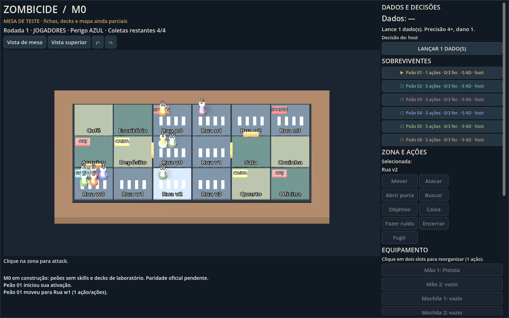

# Zombicide online — M0

Projeto Godot iniciado em 17/10/2026 a pedido do usuário, a partir da [ideia no hub](../../ideias/zombicide-online/README.md).

- Repositório: [rafaelfrecceiro/zombicide](https://github.com/rafaelfrecceiro/zombicide).
- Código: [src/project.godot](src/project.godot).
- Engine conferida: Godot **4.7.2.stable.official.ed1daf0bf**, GDScript, Compatibility.
- Alvo: PC/Steam primeiro; mobile será estudado depois.
- Hub local: `C:/Users/rafaf/Documents/Projects/Pessoal/Hub/GamesCodex`.
- Checkout: `C:/Users/rafaf/Documents/Projects/Pessoal/Hub/GamesCodex/projetos/zombicide-online`.

## Documentos

[GDD](GDD.md) · [Progresso único](progress.md) · [Decisões](decisoes.md) · [Specs](specs/README.md) · [Arte](direcao-arte.md) · [Origem e cobertura](origem/README.md).

## Estado de fidelidade

Implementação inicial da M0. Dados ainda não conferidos ficam identificados como laboratório; não é uma reprodução integral validada da caixa base. Não há assets oficiais incorporados. Regras e conteúdo faltantes são registrados em progress.md e origem/README.md.

## Execução

Abrir `src/project.godot` no Godot 4.7.2 e executar a cena principal. Instruções e verificações efetivamente realizadas em [progress.md](progress.md). O script `Iniciar-Jogo.ps1` também localiza a engine no PATH.

Nesta entrega: mesa 3D com pinos, ações/combate e dados pendentes, objetivos/fuga, inventário, save e conexão privada host+convidado. **72/72** verificações de regras/save, **22/22** de interface headless, **24/24** com GPU e teste entre dois processos aprovados. Steam, internet e partida humana completa ainda não validados.

O primeiro contato humano apontou dificuldade de entender como jogar. A revisão [UX-001](specs/UX-001.md) acrescenta guia inicial, orientação por etapa, destaque da peça ativa e dos destinos legais, e separa inventário/conexão das ações. Reteste humano ainda pendente; testes automatizados não comprovam compreensão.

A revisão [MAP-001](specs/MAP-001.md) corrige zonas, portas, distâncias e visão a partir do manual. Missões novas usam 12 zonas; saves antigos de 18 células são incompatíveis e seu carregamento preserva o arquivo e a partida atual.

Arte do runtime continua provisória. Já existem [três direções com mockups](arte/direcoes/README.md): A — Mesa de Colecionador, B — Quadrinhos Urbanos e C — Diorama Urbano. [Especificações e comparação](direcao-arte.md). Escolha pendente; imagens conceituais ainda não implementadas no jogo.
