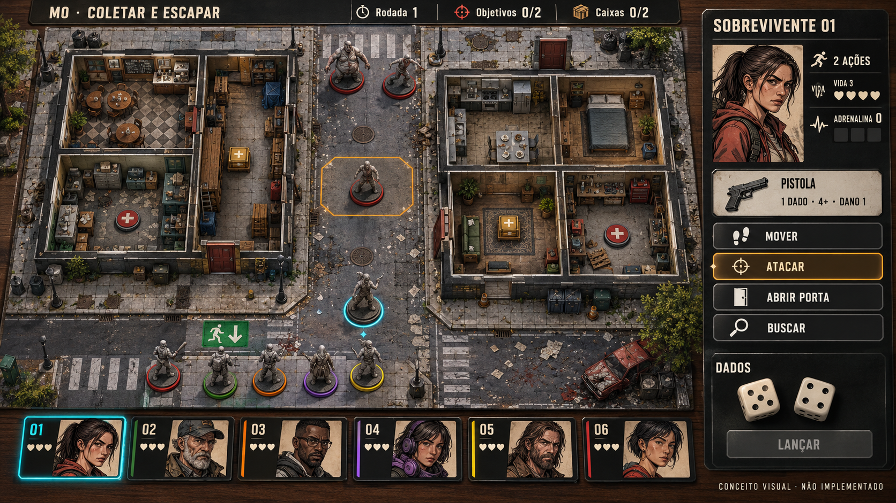
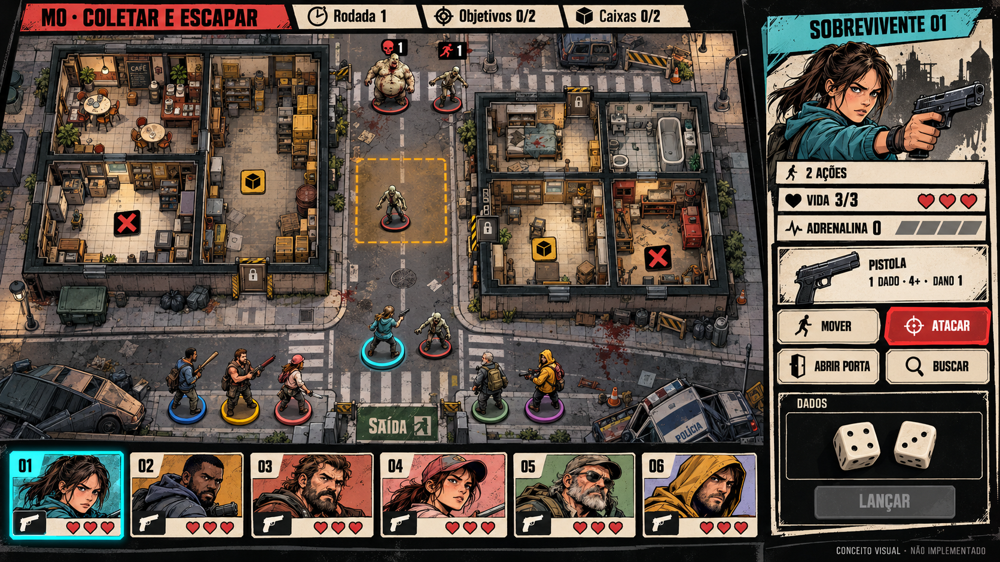
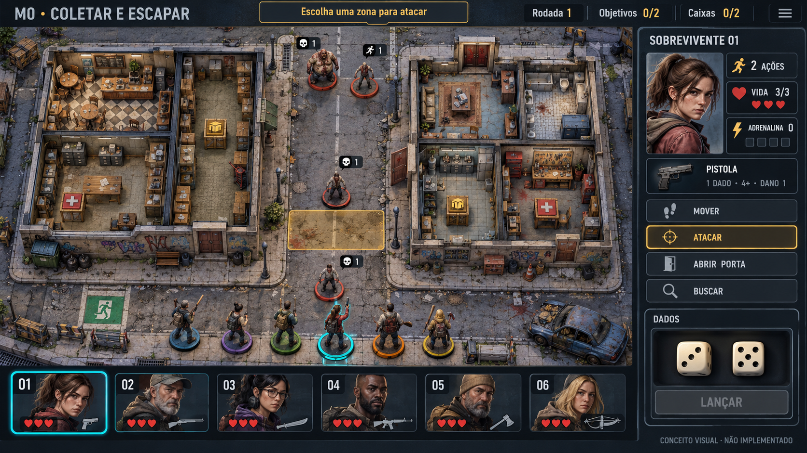

# Galeria — direções visuais

Três propostas para a mesma situação de gameplay. **Conceitos gerados, não capturas Godot. B escolhida em D-016.** [Briefing/custos/produção](../../direcao-arte.md). Prompts junto das imagens; dimensões/hashes no [manifesto](manifesto.json).

## A — Mesa de Colecionador

Tile ilustrado plano, miniaturas de resina cinza e componentes físicos. Recomendação inicial para a sensação de boardgame pedida. Esforço relativo médio.

[Prompt A](a-mesa-colecionador/prompt.md).

## B — Quadrinhos Urbanos

Tile ilustrado de contornos fortes, miniaturas pintadas e cartões creme de alto contraste. Mais expressão e trabalho de consistência gráfica. Esforço relativo médio.

[Prompt B](b-quadrinhos-urbanos/prompt.md).

## C — Diorama Urbano

Cenário em volume com paredes baixas, miniaturas pintadas e HUD tático. Mais produção/otimização de cenário. Esforço relativo alto.

[Prompt C](c-diorama-urbano/prompt.md).

Desvios de texto, contagem, pose e mapa registrados na direção de arte. Regras/mapa lógico continuam como autoridade. Escolher linguagem visual não aprova esses desvios. Na apresentação original não houve alteração de runtime; implementação posterior em [B-001](../producao/b-001/README.md).
